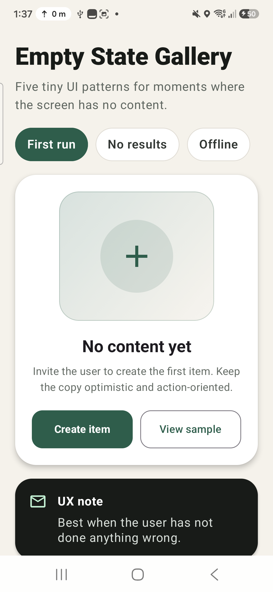

> **Ce lab a déménagé.** Il fait maintenant partie de [mobile-ui-labs](https://github.com/YANKAMKEVIN/mobile-ui-labs), qui réunit les 10 labs dans une seule app. Ce dépôt est archivé.

# Empty State Gallery

Mini-projet Android/KMP pour explorer les empty states dans une UI Compose.

Le but n'est pas de livrer une app complete, mais de montrer comment adapter le ton, l'action principale et le feedback selon le contexte :

- premier usage sans contenu ;
- recherche sans resultat ;
- mode offline ;
- permission manquante ;
- erreur recuperable.

## Pourquoi ce mini-projet ?

Un empty state n'est pas juste un ecran vide avec une illustration. C'est un moment de decision UX :

- rassurer l'utilisateur ;
- expliquer ce qui se passe ;
- proposer la prochaine action ;
- eviter de faire porter la faute a l'utilisateur.

## Stack

- Kotlin Multiplatform
- Compose Multiplatform
- Material 3
- Android target pret a lancer

## Screenshots

<p align="center">
  
</p>

## Idee de post LinkedIn

> Un empty state n'est pas un trou dans l'interface. C'est une conversation courte avec l'utilisateur.
>
> Dans ce mini-projet Compose, je compare 5 cas : first run, no results, offline, permission et error state.
>
> Chaque cas change le message, le CTA et le niveau d'urgence.

## Run

```bash
./gradlew :composeApp:assembleDebug
```
